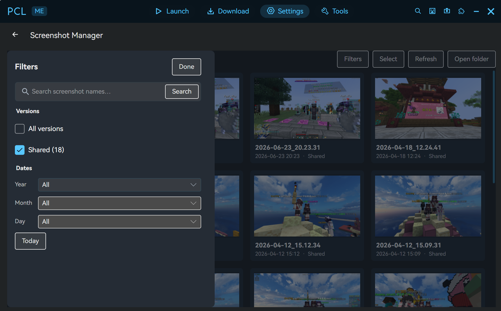

<h1 align="center">Screenshot Manager</h1>

<p align="center">
  Powerful screenshot manager extension for PCL-ME.
</p>

<p align="center">
  <a href="https://github.com/TheUnknownThing/PCL-ME">
    
  </a>
  <a href="https://www.gnu.org/licenses/gpl-3.0">
    
  </a>
</p>



A standalone PCL-ME extension that browses, filters, previews and exports Minecraft screenshots
collected from every version folder.

## Features

- Collects all screenshots (made with F2 in game). Includes shared `<minecraft>/screenshots` in a separate **Shared** group that is not counted
  under any version.
- Allows custom filters (and filename search):
  - search by screenshot name (space-separated terms),
  - year / month / day filters with an **All** option at each level and a **Today** shortcut.
- Allows selecting and exporting; users can export their preferred images to the specified folders in one click.

## Build and test

```powershell
dotnet build .\PCL.Extensions.ScreenshotManager.csproj -c Release
dotnet test .\tests\ScreenshotManager.Tests\ScreenshotManager.Tests.csproj -c Release
```

## Package and install

```powershell
dotnet publish .\PCL.Extensions.ScreenshotManager.csproj -c Release -o .\artifacts\publish

dotnet run --project ..\PCL-ME\tools\PCL.Tools.Extensions -- pack `
  .\artifacts\publish .\artifacts\PCL.Extensions.ScreenshotManager.pclext

dotnet run --project ..\PCL-ME\tools\PCL.Tools.Extensions -- validate `
  .\artifacts\PCL.Extensions.ScreenshotManager.pclext
```

Install the `.pclext` from **PCL-ME → Settings → Extensions → Install**, enable
**Screenshot Manager**, then open it from the camera toolbar button, the Extensions menu/global
search, or `Ctrl+Shift+P`.

## Usage

- **Filters**: click **Filters** in the top-right to open the overlay; click **Done** or the dimmed area to close it.
- **Version list**: check one or more versions; Shared is a separate checkbox. **All versions**
  toggles every real version.
- **Date**: pick a year to show that year, then a month and day to narrow down; **Today** selects
  the current date. All levels have an **All** option.
- **Search**: type part of the screenshot name and press Enter (typing also debounces).
- **Preview**: click a tile to open the image, with open-file / show-in-folder / copy-path
  actions.
- **Export**: click **Select**, choose images, then **Export…** and pick a destination folder.
  Existing files are not overwritten; a ` (1)` suffix is added.

## Screenshot discovery

For each instance directory `…/versions/<name>`:

1. `…/versions/<name>/screenshots`
2. `…/versions/<name>/.minecraft/screenshots`
3. `…/screenshots` (shared; labeled **Shared**, not part of any version)

If no instances are registered, the extension falls back to `%APPDATA%\.minecraft\screenshots`.
Capture dates are read from the Minecraft filename pattern `yyyy-MM-dd_HH.mm.ss` when enabled,
otherwise from the file modification time.

## Settings

| Key | Meaning |
| --- | --- |
| `include-shared` | Scan the shared screenshots folder. |
| `date-from-filename` | Prefer the timestamp in the screenshot filename. |
| `thumbnail-size` | Decoded thumbnail width in pixels (120–640). |
| `export-folder` | Last export destination (remembered). |

## Layout

```text
PCL.Extensions.ScreenshotManager.csproj
extension.json                     manifest, command, settings
ScreenshotManagerExtension.cs      activation, page/toolbar/command/search registration
ScreenshotView.cs                  filters, grid, selection, export, preview
ScreenshotTile.cs                  screenshot card with lazy thumbnail
ScreenshotScanner.cs               version/shared discovery and date parsing
ScreenshotThumbnailCache.cs        downscaled bitmap cache
ScreenshotModels.cs                item/group/scan result models
ScreenshotIcons.cs                 camera toolbar icon
Locales/*.json                     en-US, zh-Hans, zh-Hant
tests/ScreenshotManager.Tests      scanner/date parsing tests
```
